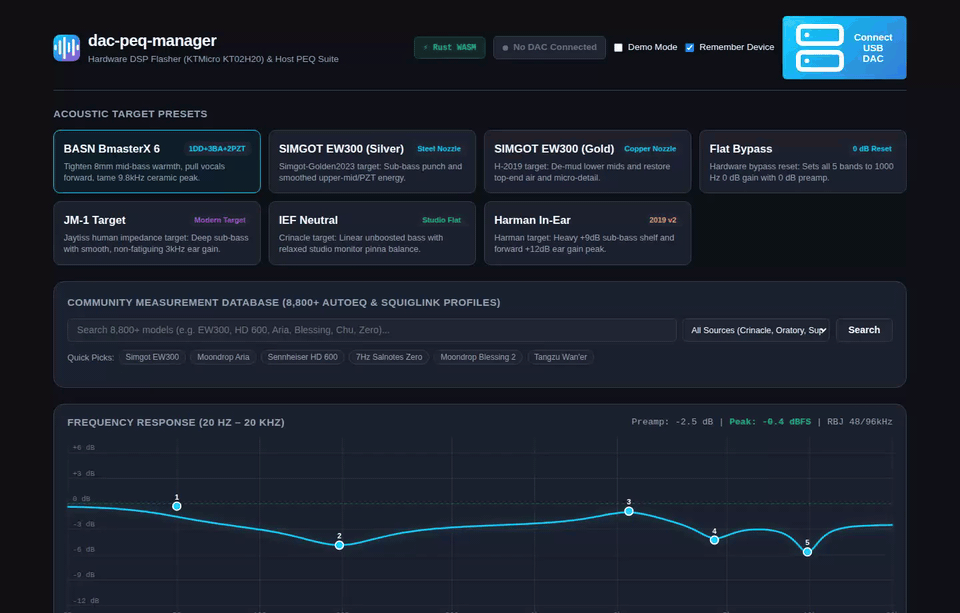
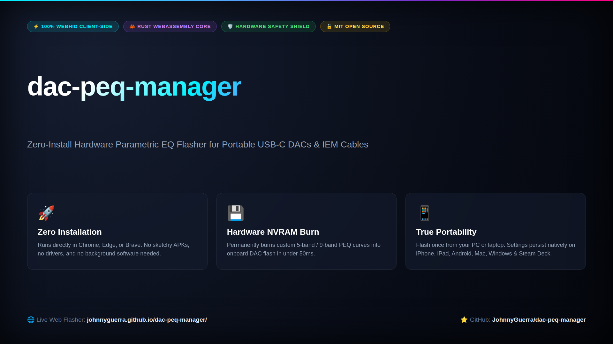
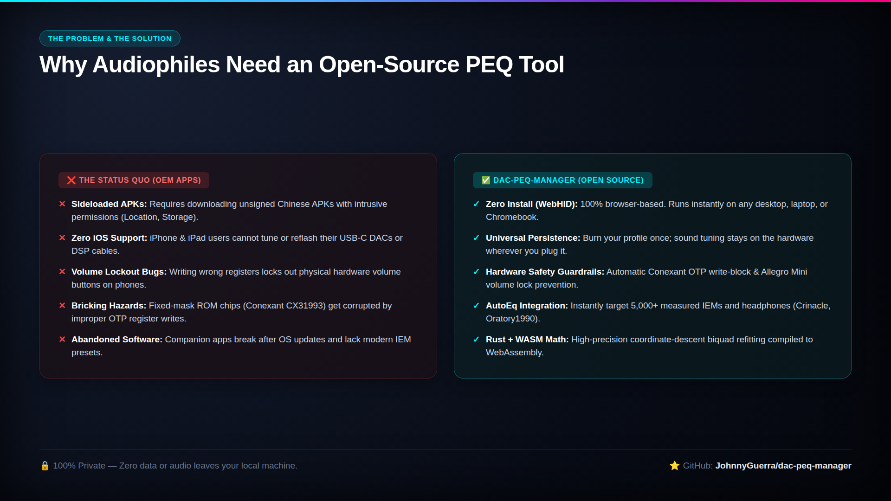
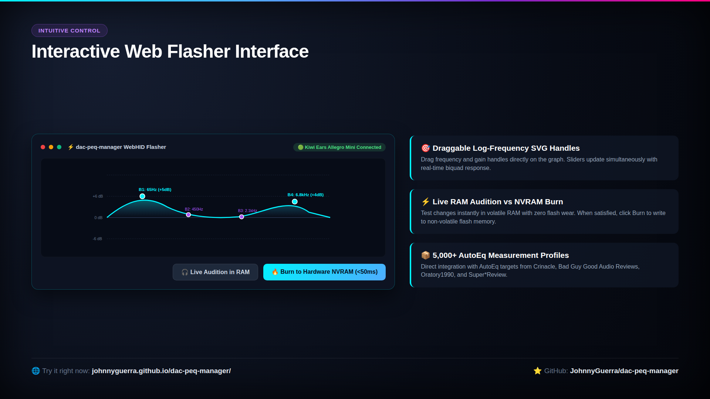
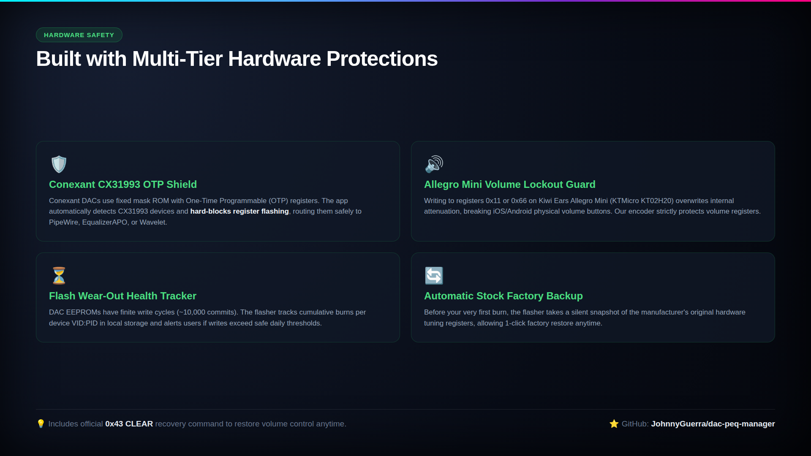
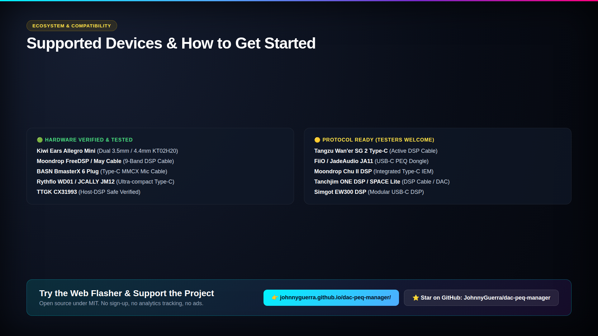

# `dac-peq-manager` (Hardware DSP Flasher & Host PEQ Suite)

[](https://github.com/JohnnyGuerra/dac-peq-manager/actions/workflows/ci.yml)
[](https://github.com/JohnnyGuerra/dac-peq-manager/releases)
[](https://github.com/JohnnyGuerra/dac-peq-manager/stargazers)
[](https://johnnyguerra.github.io/dac-peq-manager/)
[](https://github.com/JohnnyGuerra/dac-peq-manager)
[](https://opensource.org/licenses/MIT)
[](./COMPATIBILITY.md)

<p align="center">
  <a href="https://johnnyguerra.github.io/dac-peq-manager/">
    
  </a>
  <br>
  <em>⚡ Live Web Flasher in action: Drag real-time biquad curve handles, audition in volatile RAM, or burn to hardware NVRAM in &lt;50ms.</em>
</p>

An open-source hardware DSP flashing suite, WebHID browser flasher, and host equalizer bridge for portable USB-C DAC dongles, DSP upgrade cables, and In-Ear Monitors (IEMs).

Burn custom Parametric EQ profiles (including **AutoEq** targets from squig.link) directly into onboard non-volatile hardware memory (NVRAM). Settings persist natively across **iPhones, Android, Macs, Windows, Linux PCs, iPads, and gaming consoles** without running any background apps.

---

## ⚡ Try the Web Flasher (Zero Install)

Run the full hardware flasher directly in your browser via WebHID (Chrome, Brave, Edge):

👉 **[Launch Web Flasher (GitHub Pages)](https://johnnyguerra.github.io/dac-peq-manager/)**

* 100% Client-Side & Private (no audio or device data leaves your browser).
* Real-time Interactive SVG Biquad Curve with draggable band handles.
* AutoEq Database Integration (search over 5,000+ headphone & IEM measurements).
* 2-Way Hardware Readback & Live Audition in RAM before burning to flash.
* Built-in Safety Guardrails: NVRAM Flash Wear-Out Tracker & Conexant fixed mask ROM protection.

---

## 📸 Architecture & Feature Slides

<details open>
<summary><b>Click to preview presentation & feature slides (5-Slide Infographic Deck)</b></summary>
<br>

| Slide 1: Overview & Value Proposition | Slide 2: The Status Quo vs Open Source |
| :---: | :---: |
| <a href="media/slides/slide_1.png"></a> | <a href="media/slides/slide_2.png"></a> |

| Slide 3: Web Flasher UI & Biquad Curve | Slide 4: Multi-Tier Hardware Protections |
| :---: | :---: |
| <a href="media/slides/slide_3.png"></a> | <a href="media/slides/slide_4.png"></a> |

<p align="center">
  <b>Slide 5: Hardware Compatibility & Universal Portability</b><br>
  <a href="media/slides/slide_5.png"></a>
</p>
</details>

---

## 📋 Hardware Compatibility Matrix

See **[COMPATIBILITY.md](./COMPATIBILITY.md)** for our full breakdown of all **35+ cataloged DACs** across 4 status tiers:

| Status | Category | Highlighted Devices |
| :---: | :--- | :--- |
| 🟢 | **Hardware Verified & Tested** | **Kiwi Ears Allegro Mini**, **Moondrop FreeDSP / May Cable**, **TANGZU Wan'er S.G II Cable**, **BASN BmasterX 6 Plug**, **TTGK CX31993**, **Rythflo WD01**, **Bluetrum AB13X** |
| 🟡 | **Protocol Complete (Awaiting Tester)** | **TRUTHEAR KEYX**, **Tanchjim SPACE Pro**, **CrinEar Protocol Micro & Max**, **Moondrop Chu II DSP**, **Tanchjim ONE DSP**, **FiiO / JadeAudio JA11**, **Fosi Audio DS3**, **FiiO LS-TC2**, **Celest Wyvern Abyss**, **Simgot EW300 DSP** |
| 🔵 | **Protocol In Development (Help Wanted)** | **FiiO KA15**, **FiiO KA17**, **FiiO BTR13**, **ddHiFi Memory DSP** |
| 🔴 | **Fixed Mask ROM (Host DSP & Qudelix Interop)** | **Qudelix-5K Profile Sync**, **Conexant CX31993 (TTGK, JCALLY JM6 Pro)**, **Apple USB-C A2049**, **Moondrop Dawn Pro** |

---

## 🛡️ Silicon Safety & Volume Lockout Prevention

`dac-peq-manager` was built from reverse engineering physical hardware captures to eliminate common firmware bricking and volume lockout bugs:

1. **Hardware Volume Lockout Prevention:**
   * On KTMicro KT02H20 hardware (Kiwi Ears Allegro Mini), writing register `0x11` (DAC reconstruction filter from JA11) or `0x66` (preamp) overwrites internal MCU codec attenuation registers, locking out physical volume buttons on iOS/Android.
   * `dac-peq-manager` strictly restricts writes to the 5 PEQ bands (`0x26`–`0x2F`) and Slot 3 (`0x24`), guaranteeing full native volume slider response on iPhone and YouTube Music.
2. **Official Factory Reset (`0x43 CLEAR`):**
   * If volume controls are locked by other tools, zeroing bands will not restore them. The official vendor `0x43 CLEAR` command completely wipes corrupted NVRAM and soft-reboots the MCU. Available via CLI (`dac-peq-manager reset -y`) and the Web Flasher.
3. **Conexant CX31993 OTP Safety Lock:**
   * Conexant CX31993 devices use fixed mask ROM with One-Time Programmable (OTP) registers. Sending KTMicro HID register writes risks corrupting descriptors. Flashing is automatically blocked for Conexant hardware and safely routed to host-side DSP exporters.
4. **2X Clock Divisor Auto-Detection:**
   * Automatically detects whether firmware has the 2X biquad clock divisor bug (`bcdDevice <= 0x0100`), halving calculation frequencies (`f / 2`) where needed and running native clocks on modern firmwares.
5. **Physical NVRAM Wear-Out Health Tracker:**
   * EEPROMs lack wear leveling (~10k–100k cycles). The built-in counter tracks total flash commits per VID:PID and alerts users if writes exceed safe daily thresholds.

---

## 💻 CLI Quickstart (Python)

### 1. Installation

```bash
git clone https://github.com/johnnyguerra/dac-peq-manager.git
cd dac-peq-manager
pip install -e dac-peq-manager/
```

### 2. Basic Commands

```bash
# Scan and inspect connected USB DACs
dac-peq-manager scan

# Audition a preset in live RAM (instant, zero flash wear)
dac-peq-manager apply bmasterx6

# Permanently burn preset into hardware NVRAM
dac-peq-manager flash bmasterx6

# Read active PEQ bands directly from DAC hardware
dac-peq-manager read

# Factory reset NVRAM and recover volume control
dac-peq-manager reset -y

# Check flash memory burn endurance history
dac-peq-manager flash-history

# Export 10-band target profile for software equalizers
dac-peq-manager export-pipewire bmasterx6 --full-target
dac-peq-manager export-apo bmasterx6 --full-target
```

---

## 🤝 Community & Contributing

We need your help testing devices and capturing USB packets!
* Read our **[CONTRIBUTING.md](./CONTRIBUTING.md)** guide to see how to capture WebHID sendReport logs in Chrome DevTools or Wireshark.
* Own a device marked **🟡**? Submit a **[Hardware Verification Report](https://github.com/johnnyguerra/dac-peq-manager/issues/new?template=dac_hardware_report.yml)**!
* Want support for a new DAC? Open a **[New DAC Support Request](https://github.com/johnnyguerra/dac-peq-manager/issues/new?template=new_dac_request.yml)**.

---

## 📜 License & Disclaimers

* **License:** [MIT License](./LICENSE)
* **Disclaimer:** `dac-peq-manager` is an independent, community-driven open-source project. Not affiliated with KTMicro, Kiwi Ears, FiiO, Moondrop, Tanchjim, or Truthear.

---

## ✒️ Citation & Attribution

If you use `dac-peq-manager`, its reverse-engineered KTMicro/WalkPlay USB register maps, or the `dac-peq-core` Rust engine in your own project, fork, or research, please provide attribution:

```text
Guerra, J. (2026). dac-peq-manager: Open-source WebHID hardware PEQ flasher & host DSP suite for portable USB-C DACs.
GitHub: https://github.com/JohnnyGuerra/dac-peq-manager
```

```bibtex
@software{guerra2026dacpeq,
  author = {Johnny Guerra},
  title = {dac-peq-manager: Open-source WebHID hardware PEQ flasher & host DSP suite for portable USB-C DACs},
  url = {https://github.com/JohnnyGuerra/dac-peq-manager},
  year = {2026}
}
```
